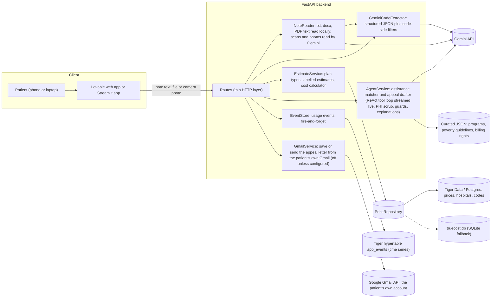
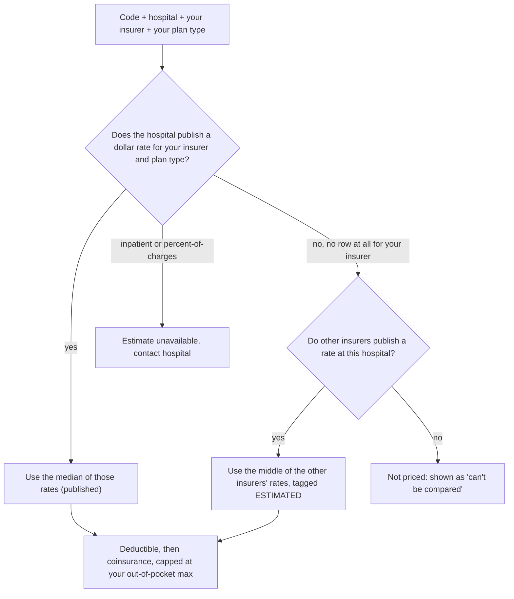
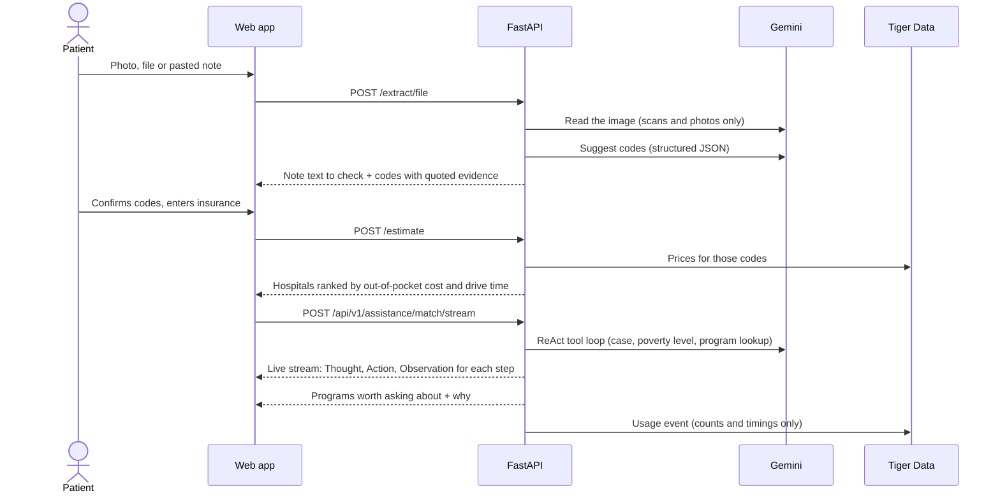

# TrueCost - know before you owe

A cost navigator for breast-cancer patients in Buffalo / Western New York (UB Hacking 2026).
A patient uploads, photographs or pastes a doctor's note. AI suggests the billing codes in it, the patient confirms them and
enters their insurance, and the app ranks seven local hospitals by **estimated out-of-pocket cost**, simulates the cost over
the care journey, and points to help paying and appeal letters.

> Facility fees only. Estimates, not bills. Patients and notes are synthetic. Hospital prices are real (public price-transparency files).

## Architecture



### Components

| Component | Where | Job |
|---|---|---|
| `repo` | `backend/app/repositories/` | Reads prices, hospitals and codes. Postgres (Tiger Data) when `DATABASE_URL` is set, otherwise the SQLite file |
| `estimator` | `backend/app/services/estimate_service.py` | Picks a rate per hospital, runs the deductible / coinsurance / out-of-pocket-max math, ranks hospitals, simulates the journey |
| `extractor` | `backend/app/services/gemini_extractor.py` | Gemini suggests codes; code drops anything off the allowed list or without a word-for-word quote |
| `reader` | `backend/app/services/note_reader.py` | Turns an uploaded file into note text. File type comes from the file's bytes, not its name |
| `agents` | `backend/app/agents/`, `backend/app/services/agent_service.py` | Financial Assistance Matcher and Appeal Letter Drafter. The matcher shows its ReAct trace (Thought, Action, Observation) live; reasons are code-written |
| `mailer` | `backend/app/services/mailer.py` | "Connect my Gmail" (Google sign-in, `gmail.compose` permission only), saving the letter as a draft in the patient's own Gmail, and sending it only after they approve. The recipient is typed by the user, a letter with blanks left is refused, and the AI never touches it. Off unless `GOOGLE_CLIENT_ID` and `GOOGLE_CLIENT_SECRET` are set |
| `events` | `backend/app/events.py` | Records one small event per main API call into a Tiger hypertable; serves live stats |

### How a price is built



### Main flow



## API

| Route | Method | What it does |
|---|---|---|
| `/` | GET | Service name and links |
| `/health` | GET | Status and which database is in use (`postgres` or `sqlite`) |
| `/extract` | POST | Suggest billing codes from pasted note text |
| `/extract/file` | POST | Same, from an uploaded PDF, PNG, JPEG, WEBP, DOCX or TXT (10 MB max). Returns the text it read |
| `/estimate` | POST | Rank hospitals by estimated out-of-pocket cost; unpublished rates become labelled estimates |
| `/simulate` | POST | Month-by-month cost at one hospital; shows when the out-of-pocket max is reached |
| `/api/v1/codes` | GET | Supported billing codes |
| `/api/v1/hospitals` | GET | The seven hospitals with addresses |
| `/api/v1/plans` | GET | Plan types with published rates for an insurer |
| `/api/v1/assistance/match` | POST | Financial Assistance Matcher: programs the patient may want to ask about, never a verdict |
| `/api/v1/assistance/match/stream` | POST | Same as `/api/v1/assistance/match`, streamed as Server-Sent Events: each Thought / Action / Observation as it happens, then the full result |
| `/api/v1/appeal/draft` | POST | Appeal Letter Drafter: a draft letter with `[PLACEHOLDER]` blanks |
| `/api/v1/appeal/send` | POST | Email the approved letter from the patient's connected Gmail (needs `approved: true`, a typed recipient, no blanks left) |
| `/api/v1/gmail/connect` | POST | Start "Connect my Gmail": returns the Google consent URL and a private session id for the browser to keep |
| `/api/v1/gmail/callback` | GET | Where Google redirects after sign-in; shows a plain "you can close this tab" page, no token reaches the browser |
| `/api/v1/gmail/status` | GET | Whether this browser session is connected to Gmail |
| `/api/v1/gmail/draft` | POST | Save the letter as a draft in the patient's own Gmail; sends nothing, blanks allowed |
| `/api/v1/gmail/disconnect` | POST | Disconnect Gmail and forget the tokens |
| `/api/v1/stats` | GET | Live usage as time series from the Tiger hypertable |

Interactive docs: `/docs`.

## Guardrails (enforced in code, not only in prompts)

- The AI never produces a price. All money math is plain, unit-tested code over the hospitals' published rates.
- A suggested code must be on the allowed list, and its evidence must appear word for word in the note (15 words or fewer).
- AI sentences are thrown away and replaced with standard wording if they add an unsupported number, say "you qualify",
  cite a law, promise an outcome or give clinical advice.
- Private details in a denial letter are replaced with placeholders before the AI sees it; real values are restored only locally.
- The agents can only call allow-listed tools, at most 5 times per request.
- If income is above every income limit in the table, the answer is written by code from the numbers ("well above the poverty level, income-based programs are unlikely to apply") with other ways to lower the bill, never a verdict.
- Temporary Gemini errors (503 "high demand", 429) are retried, then a backup Gemini model is tried, so one busy moment does not drop the AI steps.
- Every step and every program shows a reason written by code from the real values used. In the live ReAct trace, the AI's own
  "thought" sentence is shown only if it passes the same checks as all AI text; otherwise a code-written one is shown and marked as such.
  Observations are always written by code from the tool's real output.
- Usage events hold only counts, timings and fixed words, never note text or personal details.

## Data and disclosure

| Data | Source | Real or synthetic |
|---|---|---|
| Hospital prices | Public price-transparency files: Kaleida Health (Buffalo General, Millard Fillmore Suburban), Roswell Park, Catholic Health (Mercy, Kenmore Mercy, Mount St. Mary's), ECMC | Real |
| Rates a hospital does not publish for your insurer | Middle of the other insurers' published rates at that hospital | Estimates, always labelled |
| Doctor's notes, patients, denial letters, Sarah demo | Written for this project | Synthetic |
| Assistance programs and poverty guidelines | Official program pages and HHS 2026 guidelines, copied into `backend/data/*.json` with source URLs | Real, curated by hand |
| Billing codes | CPT codes chosen for breast care; ICD-10 descriptions from the CMS 2027 file | Real |

Built during the hackathon: everything in this repository. Existing: the public price files and code lists, the Gemini API, and open-source libraries.
Not covered: doctor and radiologist fees, flat copays, inpatient stays (priced by formula: "contact hospital").

## Results

Full tables, method and limits: [eval/RESULTS.md](eval/RESULTS.md).

| Test | Result |
|---|---|
| Code extraction, 15 synthetic notes (final prompt) | 15/15 perfect, precision 1.00, recall 1.00, 0 invented codes |
| Same notes, first prompt / keyword baseline | 13/15 / 6/15 |
| Agent checks, 10 cases | 94/94 checks passed |
| Unit and API tests | 178 passing |

The answer keys are drafts that no clinician has verified.

## Run it

```bash
pip install -r backend/requirements.txt
cd backend && python -m uvicorn app.main:create_app --factory --port 8010      # API, docs at /docs
cd backend && python -m pytest -q                                              # tests
cd frontend && TRUECOST_API=http://127.0.0.1:8010 streamlit run app.py         # Streamlit app
```

Settings go in `.env` (copy `.env.example`): `GEMINI_API_KEY`, and optionally `DATABASE_URL` + `PGPASSWORD` for Tiger Data.
Without `DATABASE_URL` the app uses `truecost.db`. On Windows, `start_backend.bat` starts the API and `start_tunnel.bat` adds a public tunnel.
Deploying on a server: [deploy/DEPLOY.md](deploy/DEPLOY.md). The Lovable client is `lovable/api.ts`.

Rebuild the database from the raw price files (about 17 GB, not in this repo):
`TRUECOST_DATA=/path/to/data python scripts/build_db.py`, then `python scripts/migrate_to_postgres.py` to load Tiger Data.

## Repository layout

```
backend/app/         api -> services -> domain + repositories, wired in container.py
backend/app/agents/  assistance matcher, appeal drafter, tool loop, guards, explanations
backend/data/        curated programs, poverty guidelines, Postgres schema, cached demo answers
backend/tests/       unit and API tests
frontend/            Streamlit app
lovable/             typed API client and prompts for the Lovable web app
eval/                extraction and agent evals, results, judge Q&A
scripts/             build_db.py, migrate_to_postgres.py, record_demo.py, validators
deploy/              Vultr install scripts (systemd + Caddy)
truecost.db          SQLite copy of the price data
```

## Keeping this README current

The diagram and the tables above are part of the code. Update them in the same change whenever the architecture changes:
a new route, a new component in `container.py`, a new external service, or a new data source.
`backend/tests/test_readme_architecture.py` fails if a route or a `Container` component is missing from this file.
